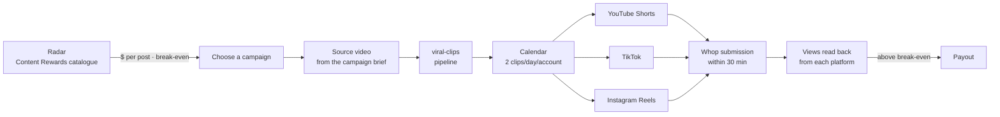

<div align="center">

# 🎬 viral-clips

**From a one-hour video to a week of vertical clips, and from those clips to paid campaigns on Whop.**

A [Claude Code](https://claude.com/claude-code) skill that turns long-form video into 9:16 short-form clips for TikTok, Instagram Reels and YouTube Shorts, plus the operation around it: finding the campaigns that pay, publishing on a schedule, and reading the numbers.


[What it does](#what-it-does) · [How it works](#how-it-works) · [Monetization on Whop](#from-clips-to-income-whop) · [Design principles](#design-principles) · [Quick start](#quick-start) · [🇮🇹 Italiano](#-in-italiano)

</div>

---

## The problem

Podcasts, interviews and streams are long. The audience is on short-form feeds. In between there is a market: on **Content Rewards (Whop)**, brands and creators publish *clipping campaigns*. They hand out their long videos and pay a CPM, so much per thousand views, to whoever turns them into clips that perform.

Cutting good clips by hand takes hours per video. The automated tools on the market have two flaws:

1. **They hand the editorial choice to a paid LLM API** (OpenAI, Gemini) and pick moments by guessing "virality". Clips start and end in the wrong place.
2. **They stop at the clip.** Choosing the campaign, publishing on three platforms from the right account, submitting to Whop within the deadline and checking whether a clip pays: all of that stays manual.

**viral-clips does both halves, locally and for free.**

## What it does

```text
 one link  ──►  transcript + signals  ──►  Claude picks the moments  ──►  rendered 9:16 clips
                                                                                │
 Whop campaign  ◄──  submission  ◄──  YouTube · TikTok · Instagram  ◄──  calendar
```

| Step | What it does |
|---|---|
| 🎙️ **Transcription** | `faster-whisper` *large-v3-turbo* with word-level timestamps, Italian and English, language restricted to avoid hallucinated decodes |
| 📈 **Signals** | Audio energy, pauses, DSP laughter detection, scene cuts aligned to the exact frame, face composition |
| 🧠 **Editorial selection** | Claude reads a compact segment view and decides which moments **stand on their own**, where they start and end, the hook and the keyword to highlight |
| 🎥 **Virtual camera** | A 9:16 crop that holds a pose and cuts instead of chasing. The subject is chosen once per shot, speaker detection reads mouth-pixel variance, and emphasis punch-ins land on the keywords |
| ✍️ **Subtitles** | Word-by-word karaoke ASS with every word positioned independently (measured from the TTF, matching libass within 1 px), plus a hook overlay with one yellow accent word |
| ✂️ **Silence cuts** | Removes only stretches that are wordless *and* quiet, never near a shot change, never leaving a fragment too short to read |
| ✨ **Motion graphics** | Animated templates (numbers, lists, before/after…) rendered offline with HyperFrames, timed to the spoken word |
| 🎞️ **One-pass render** | Trim, dynamic crop, scale, subtitles, graphics and two-pass loudnorm in **a single ffmpeg filtergraph**: one encode generation, x264 CRF 17, BT.709 colour tags and HDR tone mapping |
| 🛰️ **Campaign radar** | Reads the whole Content Rewards catalogue, ranks campaigns by expected **$ per post**, computes the break-even views and resolves each campaign's source video |
| 📤 **Publishing** | Official APIs first (Instagram Graph API, Buffer for TikTok), a scheduling calendar, a warm-up ramp for new accounts, and an identity check before every upload |
| 💸 **Whop submission** | Submits each post to its campaign within the 30-minute window, checks that intake is open, and reads earnings and payout status |
| 🖥️ **Control panel** | A local web dashboard: today's tasks, campaigns by niche, production, publishing queue, numbers and a "Ask Claude" tab |

## How it works

### The core idea: scripts do the mechanics, Claude does the editing

```mermaid
flowchart LR
    A[Link or local file] --> B[ingest<br/>download · 480p proxy]
    B --> C[transcribe<br/>whisper, word timestamps]
    C --> D[signals · faces<br/>energy · pauses · cuts]
    D --> E[windows.py<br/>compact segment view]
    E --> F{{Claude<br/>editorial judgement}}
    F --> G[decisions.json<br/>borders · hook · keywords · scores]
    G --> H[validate.py<br/>borders on word boundaries]
    H --> I[track_subject · camera<br/>virtual camera plan]
    I --> J[render_clip<br/>one ffmpeg pass, full resolution]
    J --> K[(output/ 9:16 clips<br/>+ clips.md)]
```



Everything deterministic is a script: download, transcription, faces, signals, render. The one step that needs *judgement*, deciding which moments hold up, is written by Claude into `decisions.json`. That file is the contract: re-rendering tomorrow never means re-judging, and `validate.py` rejects any clip whose borders cut through a word.

The two halves never mix. All analysis runs on a **480p proxy** (on 4K, scene detection simply never finished), and only the final render touches the full-resolution source, with coordinates rescaled.

### The selection criterion: self-containment, not virality

A clip ships if it **stands on its own**: premise, development and payoff inside the clip, with no context from the rest of the video. Six dimensions (hook, self-containment, emotional arc, concreteness, friction, charge) are scored on three levels, *weak / solid / strong*, but they only **describe** the clip. Only self-containment decides. Predicting an audience is guesswork, while whether a clip makes sense alone can be read from the text.

Minimum 20 seconds, no upper cap, and no cap on the number of clips: every moment that holds up gets delivered.

## From clips to income: Whop



**Choosing what to work on.** A campaign is ranked on **dollars per post** (expected views per post × the CPM actually paid on *our* platforms), not on budget and not on dollars per clipper. Next to it sits the **break-even**: below `minimum payout / CPM × 1000` views a clip earns nothing, and for a young account that is the binding constraint. Virality is capped by the per-clip ceiling, so the work is in the median.

**Reading the brief.** Each campaign's niche, page requirements and constraints are judged by Claude reading the full brief, never computed from a regex. A campaign brief can *tighten* the base rules (shorter max length, no exaggerated hooks) but never loosen them.

**Accounts.** One account group per niche (YouTube + TikTok + Instagram + one Whop account), because the identity of a page is what the audience follows. New accounts warm up by doing nothing for a week, then ramp to 1, 2 and 3 posts a day. Steady state is two clips a day, which is where the largest clipping channels sit, below the spam threshold.

**Safety rails.** Before any upload the connected account is compared with the expected one: if they differ, or if either is unknown, nothing is published. Platforms can be paused with a recorded reason. A submission is judged only once Whop confirms it, with three distinct outcomes (`submitted`, `not registered`, `not verified`), and a failed one lands in a manual queue with a desktop notification instead of blocking the run.

> **Note on publishing.** The project uses official channels wherever a platform allows it (Instagram Graph API, Buffer for TikTok, YouTube Data API once audited). Where no official route exists yet, a Playwright browser bridge fills the gap. Check each platform's terms before using it.

## Design principles

- **Free and local, as a hard requirement.** No paid API, no credits, no video upload, no mandatory proprietary model. A technically better option that needs one gets rejected.
- **One command, honestly.** `run.py prepare` stops where judgement is needed, `run.py render` picks up afterwards, and `automatico.py` chains both through `claude -p` with a mechanical check after every model step.
- **Quality equal to the source.** Re-encoding is unavoidable (crop + burned subtitles), so it happens exactly once, from the highest available resolution.
- **Edge cases don't crash, they go quiet.** A wrong delivery looks like a successful one, so anomalies are shown at the top of the view Claude reads, and the delivery gate inspects the actual files: a zero-byte mp4 does not pass.
- **Tests pin decisions, not lines of code.** The suite (standard-library `unittest`, no video, no network) fixes the numbers and conditions that would fail silently weeks later: a throttled account, a clip cut mid-word, a clip posted from another niche's account. Mutation testing checks that each test actually bites.
- **Measure the machine, don't type it.** Thread counts come from physical cores, timings record CPU and power source, and decisions that rely on a benchmark keep the benchmark next to them (hardware acceleration was measured *slower* on 4K → no `-hwaccel`).

## Tech stack

| Area | Tools |
|---|---|
| Speech | faster-whisper (CTranslate2), word timestamps, VAD |
| Vision | OpenCV · YuNet face detector (227 KB, no torch) · PySceneDetect |
| Video | ffmpeg · x264 · libass · loudnorm · zscale/tonemap |
| Graphics | HyperFrames CLI (offline, network disabled) · GSAP |
| Download | yt-dlp (YouTube, TikTok, Google Drive) |
| Automation | Playwright · Instagram Graph API · Buffer |
| Editorial | Claude Code (`claude -p`, model and effort pinned per caller) |
| Panel | Python standard-library HTTP server + vanilla JS |

No GPU, no `torch`, no `mediapipe`: everything runs on a laptop CPU.

## Quick start

**Requirements:** Windows 10/11 with `winget` (a Linux `setup.sh` is included), and [Claude Code](https://claude.com/claude-code). The setup installs everything else: ffmpeg, a dedicated Python 3.12, a virtualenv, the Whisper models, YuNet and the fonts.

```powershell
git clone https://github.com/T0mmyBB/viral-clips-public
cd viral-clips-public
powershell -ExecutionPolicy Bypass -File .claude/skills/viral-clips/scripts/setup.ps1
```

The setup is idempotent. Then, from `.claude\skills\viral-clips\scripts\` with `.venv\Scripts\python.exe`:

```powershell
# 1. everything needed to choose: download, transcript, signals, anomalies
python run.py prepare "<url or path>" --audio-lang en

# 2. the editorial step: open Claude Code in the project and ask for the clips.
#    It reads the segment view (windows.py), writes decisions.json, validates it.

# 3. render the chosen clips into output/<video>/
python run.py render <work_dir>
```

Or end to end, judgement included, with no stop in the middle:

```powershell
python automatico.py --campagna <campaign-uuid> --sorgente "<url>"
```

**The operation (optional).** Fill in `dashboard/identita.json` with your accounts (it ships as an empty example), install the publishing dependencies with `publish/setup.ps1`, and start the panel:

```powershell
.venv\Scripts\python.exe dashboard\server.py
```

## Repository layout

```text
.claude/skills/viral-clips/
  SKILL.md          how Claude runs the pipeline, step by step
  scripts/          the pipeline: ingest, transcribe, signals, faces, camera, render…
  references/       selection rubric, subtitle styles, external research
  grafiche/         HyperFrames motion-graphics templates
radar/              Content Rewards catalogue, ranking, niches, source resolver
publish/            calendar, rhythm, identity registry, platform agents, Whop
dashboard/          local control panel
tests/              decision-pinning unit tests (stdlib only)
tools/banco_modelli blind benchmark before switching a Claude model
docs/               roadmap template, research, specifications
CLAUDE.md           stable decisions and lessons already paid for, with the why
```

The code and its documentation are written in Italian. [`CLAUDE.md`](CLAUDE.md) is the most interesting read for a developer: every rule comes with the reason it exists and, where relevant, the measurement that settled it.

## Why I built it

I study Economics and Finance, and I learn a lot from long videos. I noticed that the short clips of those videos are a real market, with brands paying per view, and that the tools serving it either cost money per minute or leave the most important part, the choice, to guesswork.

So I built my own. I started with the mechanical pipeline and kept the editorial judgement as a separate, explicit step. Then I built the rest of the business around it: which campaigns are worth the time, which accounts publish what, and when a clip actually pays. Along the way the project became an exercise in running a small operation with near-zero budget. You measure before you decide, you write down why, and you build guardrails so that a mistake stops the machine instead of spreading quietly.

---

## 🇮🇹 In italiano

**viral-clips** è una skill di Claude Code che trasforma un video lungo (un'ora o più, da link o da file) in clip verticali 9:16 pronte per TikTok, Reels e Shorts. Intorno alla skill c'è tutta l'operazione per **monetizzarle sulle campagne di clipping di Whop (Content Rewards)**: un radar che sceglie le campagne che rendono di più a post, la pubblicazione a calendario su tre piattaforme, l'invio a Whop e la lettura dei numeri.

**Il principio:** gli script fanno il lavoro meccanico (download, trascrizione, volti, segnali, render in un solo passaggio ffmpeg), Claude fa quello editoriale (quali momenti reggono da soli, dove iniziano e finiscono, l'hook). Il criterio di selezione è l'**autoconclusività, non la viralità**: una clip esce se si regge da sola.

**I vincoli:** tutto gratuito e in locale, nessuna API a pagamento, nessuna GPU; qualità pari al sorgente, con una sola generazione di encode.

**Lato business:** le campagne si scelgono sui dollari attesi per post e sul break-even di views, un gruppo di account per nicchia, una rampa di riscaldamento per gli account nuovi, due clip al giorno a regime, e un controllo dell'account collegato prima di ogni caricamento.

Codice e documentazione interna sono in italiano: il punto di partenza è [`CLAUDE.md`](CLAUDE.md), che raccoglie le decisioni stabili e le trappole già pagate, ognuna col suo perché.

---

<div align="center">

**© Tommaso. All rights reserved.**<br/>
This repository is public so the work can be read and evaluated. No license is granted:<br/>copying, modifying or redistributing the code requires written permission.

</div>
